# Visual inventory — every mark ocpm-viz can draw

> Captured 2026-08-23, before the Process page. Its marks — activity nodes, succession arcs and
> loops, dashed cross arrows, count labels, the process card, the Successions and Activities
> sections and the legend's Process map section — are not inventoried here.

A catalogue of the tool's visual vocabulary, from the single glyph to the whole canvas.
Captured **2026-08-23** from the working tree, running `npm start` on `http://localhost:8000`
against the **fixtures** source (plus three shots from the live database, marked `DB*`).

Nothing in the repository was modified to produce this. The only files written are
`online-appendix/visual-inventory/INVENTORY.md` and `online-appendix/visual-inventory/shots/*.png`.

The checklist of what *should* exist came from `docs/_ground_truth.md` §6–§8,
`src/render/theme.js` and `src/render/legend.js`. Where the picture and those documents
disagree, the picture is recorded here and the disagreement is noted in
[§J](#j-observations-the-capture-turned-up).

---

## Method

`scripts/shot.mjs` takes one screenshot per process and writes to `.shots/`, so it could
not be used: this inventory needs *interaction* (hovering a mark, opening a sidebar
disclosure, dragging a node, pinning a tooltip) and it must not write outside
`online-appendix/visual-inventory/`. Instead the shots were driven over the Chrome DevTools Protocol.

The mechanics, because they were not obvious:

- The only browser on this machine is Microsoft Edge on the Windows side, reached through
  WSL interop. It binds its debug port to `127.0.0.1` and ignores
  `--remote-debugging-address`, and Windows Firewall blocks inbound connections from the
  WSL adapter — so a CDP client running inside WSL cannot reach it. A TCP relay on the
  Windows side was tried and blocked at the same firewall.
- So the driver runs **on the Windows side, over loopback**: a hand-rolled WebSocket +
  CDP client in Python's standard library (no websocket package is installed and pip has
  no network). It lives outside the repo, in `C:\temp\ocpm-vi\`.
- Each capture is a *scene*: navigate, wait for a readiness predicate, run steps
  (`hover`, `click`, `rclick`, `drag`, `key`, `js`, `scrollTo`), then screenshot with an
  optional clip computed from a live element rectangle.
- Interaction uses real `Input.dispatchMouseEvent` events, not synthetic DOM events,
  because the tooltips and the drag simulation read pointer coordinates and button state.
- Micro items are cropped to a fixed window centred on the element and magnified 2–6×.
  A bare `getBoundingClientRect()` of an SVG group often spans a whole lane — one early
  attempt at cropping a 9×9 marker produced a 630×13240 image — so crops are centred
  windows, not bounding boxes.
- Motion shots set `prefers-reduced-motion: no-preference`; every other shot forces
  `reduce`, so nothing drifts between captures.
- LIVE2 draws a 6482 px-tall canvas inside `#scroll`. Anything below the fold is scrolled
  into the container before it is measured and cropped.

Fixtures were chosen by probing which `data-legend` keys each one actually renders,
rather than by assuming. That probe is reproduced in [§J](#j-observations-the-capture-turned-up)
because it corrects two fixture attributions.

---

## A. Object glyphs

### A1 · Issue mark — circle

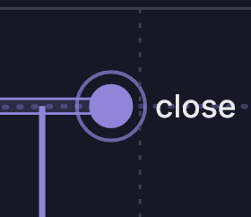

**Where:** issue lane, node layer, every time mode. **Encodes:** one event on one issue.
Filled circle in the object's shade; the ring at the right is the `IssueClosed` landmark,
and the hollow circle below is a comment. The horizontal band is the lifecycle bar, the
dotted curve the comment connector.
`data-legend="issue"` · `TYPE.issue.shape = 'circle'` (`src/render/theme.js:21`).

### A2 · Pull request mark — diamond

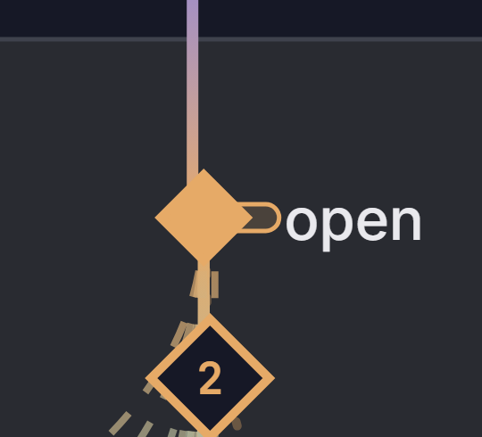

**Where:** pull_request lane. **Encodes:** one event on one PR. Drawn by `drawSymbol` as a
path `M0 -s L s 0 L 0 s L -s 0 Z` with `s = size × 1.2` (`theme.js:203`).
`data-legend="pull_request"`.

### A3 · Commit mark — square

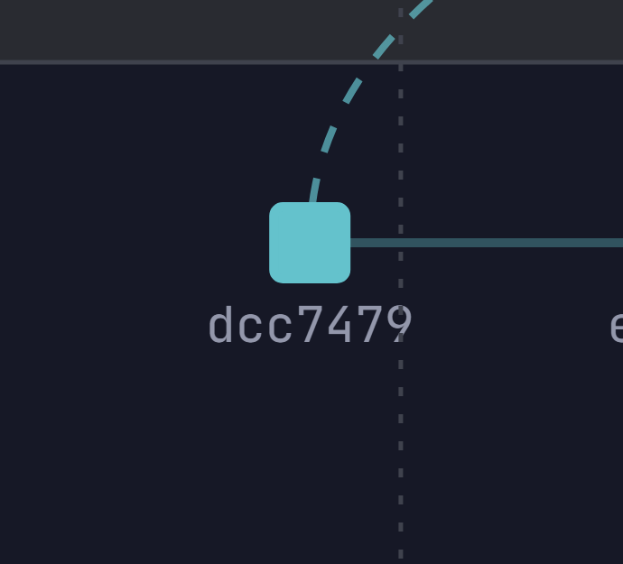

**Where:** commit lane. **Encodes:** one `CommitObserved` event — a commit seen in a push.
Rounded rect, `rx 2`. `data-legend="commit"`.

### A4 · Comment mark — hollow lane shape

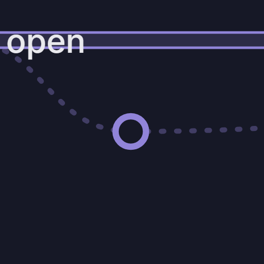

**Where:** issue and pull_request lanes. **Encodes:** an `IssueCommented` or `PullRequestCommented` event. Same shape
as its lane, but hollow — `fill: var(--color-bg)`, stroke 2.5, size 6 against 8 for a
normal mark. Hollow is the comment's own cue, which is why the abandoned PR and the repeat
observation had to find other devices. `data-legend="comments"`.

### A5 · Per-object shades

Hue says *which type*; shade says *which object*. Index 0 is exactly the type's base
colour, so a one-issue-one-PR sub-log renders as it did before shades existed.

**Issue family** — 4 of the 6 shades, from LIVE2's four issues (relationships/Rows):

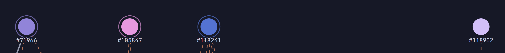

**PR family** — all 6 shades, cycling across LIVE2's 24 PRs:

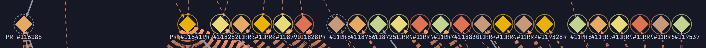

Base orange, gold, deep red-orange, saturated amber, muted brown-orange, pale yellow-green,
then repeat. `OBJECT_SHADES` (`theme.js:72`); `shadeCount('issue') = 6`,
`shadeCount('pull_request') = 6`, `shadeCount('commit') = 1` — commits are one node each
and never need separating from a sibling. No fixture holds six or more issues, so the two
remaining issue shades are not capturable; they are pinned to the accent's blurple at
`oklch(66% 0.17 305)` and `oklch(72% 0.06 282)`.

### A6 · Landmark ring

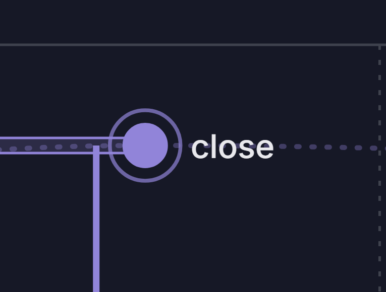

**Where:** on an `IssueClosed` or `PullRequestMerged` mark. **Encodes:** a terminal activity
the platform itself asserts. Radius `size + 6`, stroke in the node's colour, width 1.5 at
0.7 opacity. `data-legend="landmark"`.

### A7 · Heuristic landmark ring — merged off-platform

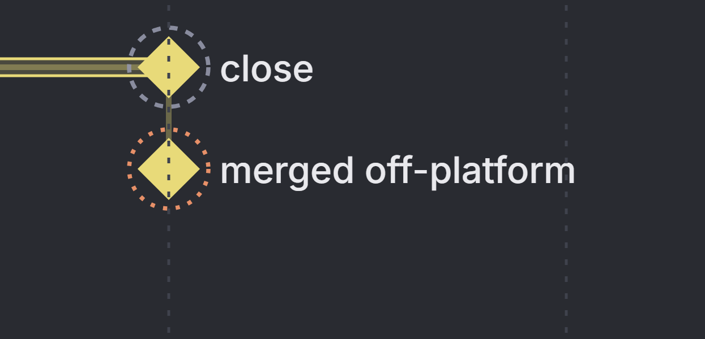

**Where:** on a `PullRequestMergedOffPlatform` mark (F14). **Encodes:** a merge we inferred
rather than one GitHub recorded. Dotted `1.5 3` in `COLORS.extracted`
(`oklch(78% 0.13 45)`) so it can never be mistaken for the platform's own merge —
decision 123. `data-legend="landmark-heuristic"`.

### A8 · Closed-unmerged ring

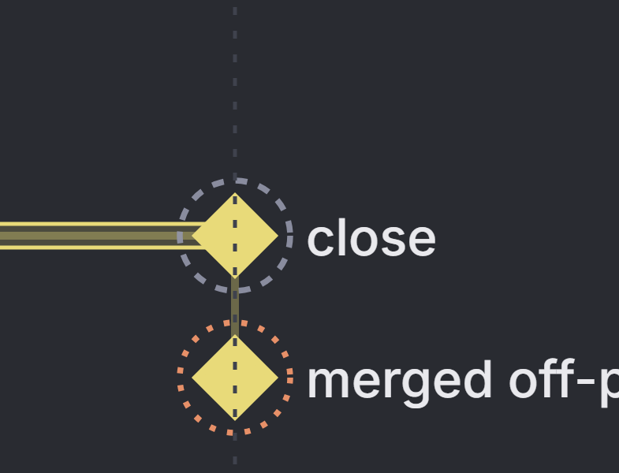

**Where:** on a `PullRequestClosed` mark that never merged (F14, and F1's own PR).
**Encodes:** an abandoned pull request. Dashed `3 3` in `var(--color-neutral-500)` — grey,
not the extracted orange, because nothing was inferred here.
`data-legend="closed-unmerged"`.

### A9 · Repeat-observation marker

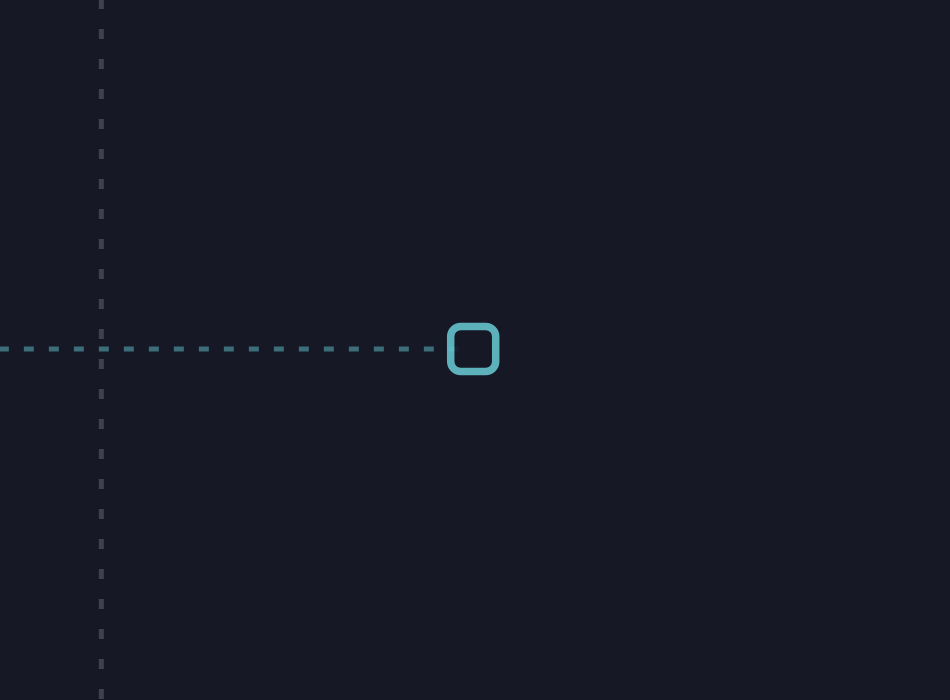

**Where:** commit lane, on the `repeatRow` below the commit's own row (LIVE1, LIVE2).
**Encodes:** the same commit seen again in a later push. Small hollow square, r 4.5, joined
to its first observation by a dashed `2 3` elbow. `data-legend="repeat-observation"`.

### A10 · Commit labels and their thinning

Abbreviated SHA under each commit, in F1:

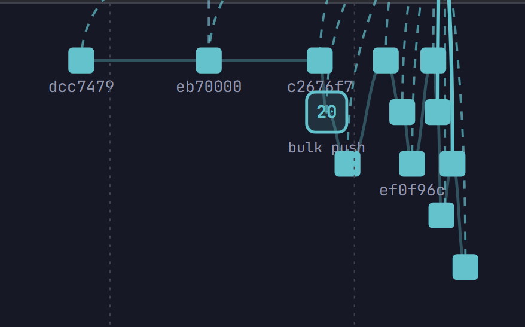

The same labels in F10, where 300 commits crowd the lane and most are dropped:

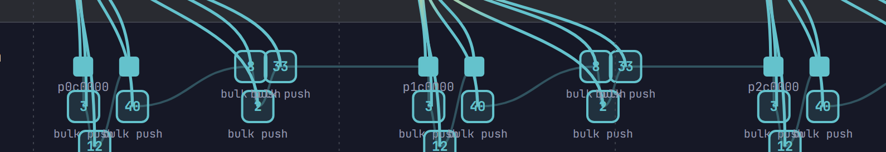

**Encodes:** `left(sha, 7)`. Labels are thinned when neighbouring commits are closer than
64 px, so the lane degrades to unlabelled squares rather than to overprinted text.

---

## B. Folding and bursts

### B1 · Folded push burst

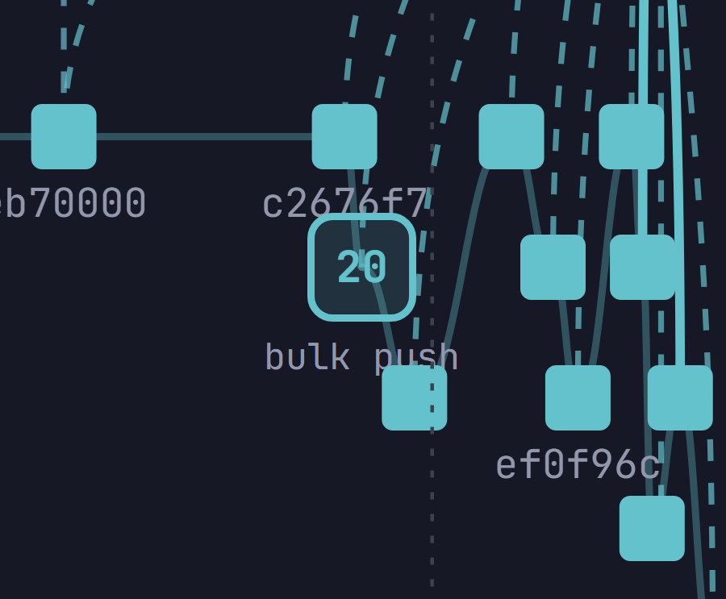

**Where:** commit lane. **Encodes:** every commit sharing one `push_id`, when there are at
least two (`MIN_BURST = 2`). A 28×28 rect, `rx 6`, commit colour at 0.15, with the member
count and the caption *bulk push*. Id `burst:<push_id>` — client-side only, derived in
`src/model/bursts.js`. `data-legend="burst"`.

### B2 · Expanded push burst and its fold handle

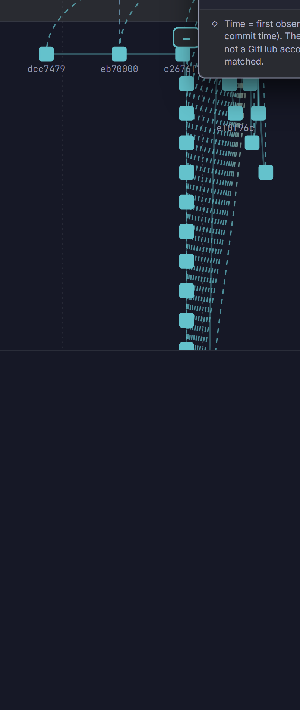

Clicking the burst unfolds its members (F1's burst holds 20). The `−` handle above the run
folds it back:

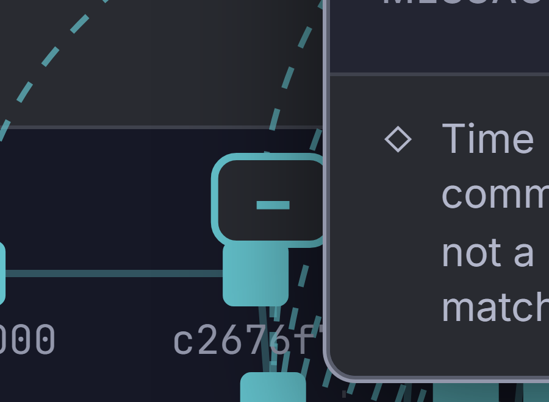

**Encodes:** the individual commits, laid out on their own rows. Expanding F1's burst also
brings the `×N` crowded badge into existence — 20 new links to one PR exceed what can be
fanned. Handle carries `data-tip="fold.handle"`; `renderBurstHandles`
(`src/render/nodes.js:588`).

### B3 · Comment burst and its handle

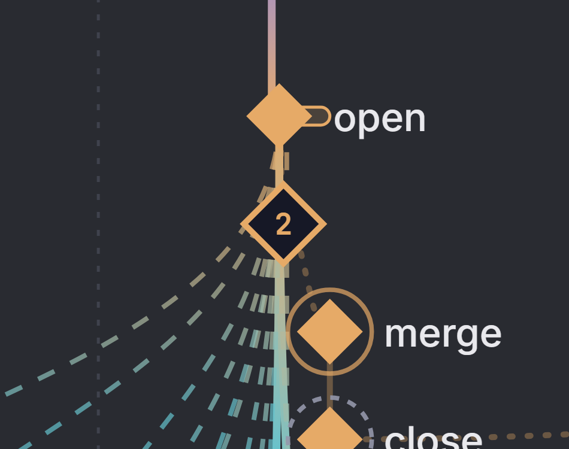

**Where:** issue and pull_request lanes. **Encodes:** a run of comments closer together than
the folding window (`DEFAULT_COMMENT_WINDOW_DAYS = 1`), collapsed to one mark. Hollow lane
shape, size 11, carrying the count. Id `cburst:<first_event_id>`.

Expanded, with the `−` fold-back handle above the run:

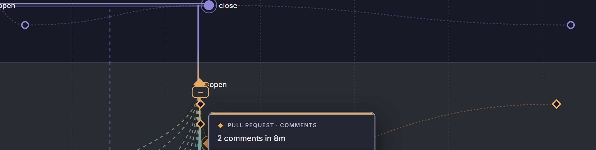

Both the folded glyph and the fold-back handle carry `data-legend="comment-burst"` — the
handle *replaces* the glyph rather than adding to it (`nodes.js:694`).

### B4 · Burst node in relationships mode

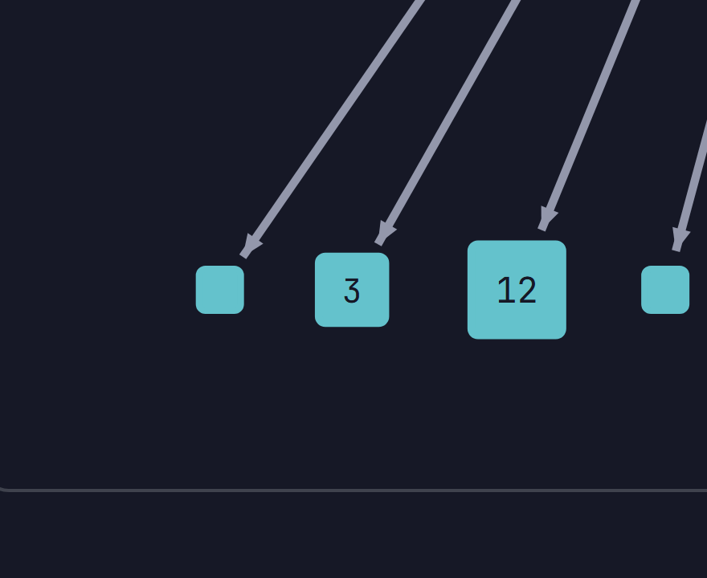

**Where:** relationships mode only. **Encodes:** the same folded push, sized by content
rather than fixed: `burstRadius(size) = 6.5 + √size × 2.2` (`src/layout/structural.js:55`),
drawn as a square.

---

## C. Lines and links

### C1 · Lifecycle bar

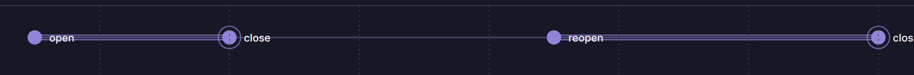

**Where:** bg layer, issue and pull_request lanes only — commits are points, not spans.
**Encodes:** one bar per interval. F9's reopened issue therefore draws **two** bars on one
row: opened→closed, then reopened→closed. Height 6, `rx 3`, the object's shade at 0.18
opacity. `renderLifecycleBars` (`src/render/nodes.js:23`).

### C2 · Lifecycle bar in discrete mode

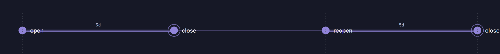

**Encodes:** the same intervals, but with real duration no longer readable from x — so the
duration is written on the bar and the fill drops to 0.08.

### C3 · Sequence line, with dashed comment segments

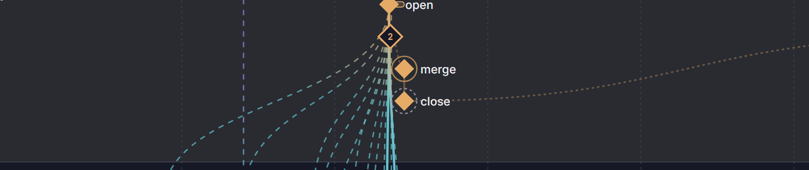

**Where:** seq layer, one per object. **Encodes:** that object's own history in order. The
object's shade at 0.35, width 2; segments that end in a comment switch to a `1 5` dash, so
comment traffic is visible as texture without competing with the events.
`data-legend="sequence"`, and `data-legend="comments"` on the dashed portions.

### C4 · Evidence classes — validated against extracted

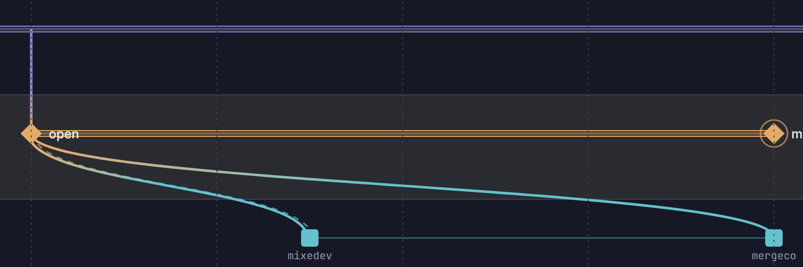

**Where:** link layer, every mode. **Encodes:** how much the link can be trusted.
Validated is solid, width 2.6, opacity 1; extracted is dashed `6 6`, width 1.6, opacity
0.7 (`EVIDENCE_STYLE`, `theme.js:142`). F12 puts both classes on the *same* commit↔PR pair,
which is the solid line with a dashed line running alongside it at left. This is the visual
answer to shortcoming S8: solid means the platform asserted it, dashed means we parsed a
convention nobody enforces.

### C5 · Link gradient

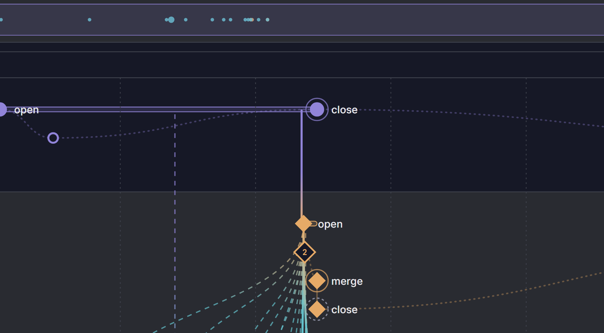

**Encodes:** direction and endpoints. Each link is painted with an SVG gradient running
from the source object's shade to the target's, so an edge reads as "from this kind of
thing, standing in this relation to that one". The gradients are `<defs>` entries named
`grad_<source>_<target>_<qualifier>_<evidence>`.

### C6 · Fanned links and the crowded badge

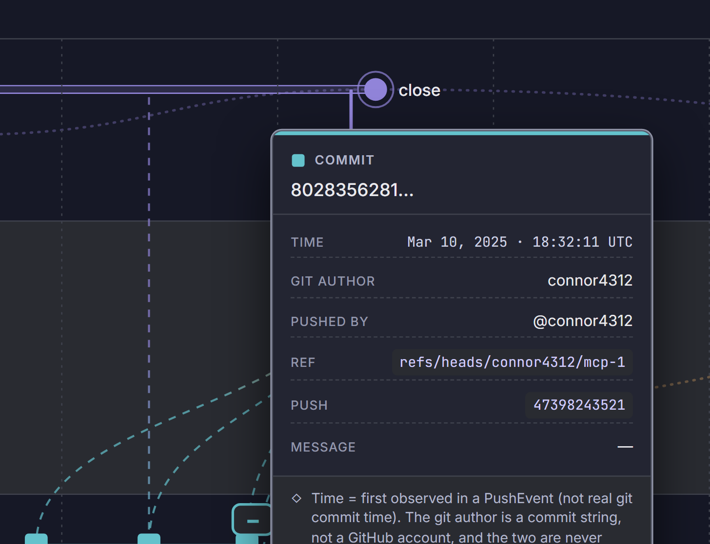

**Encodes:** several links sharing one endpoint. Up to 6 parallel links fan at 5 px
spacing; beyond that they collapse to a `×N` badge rather than a solid smear. Shown here
in F1 with the 20-commit burst expanded. `data-legend="link-crowded"`. The reasoning is
worked through in `docs/LINK_FANNING.md`.

### C7 · Qualifier colouring

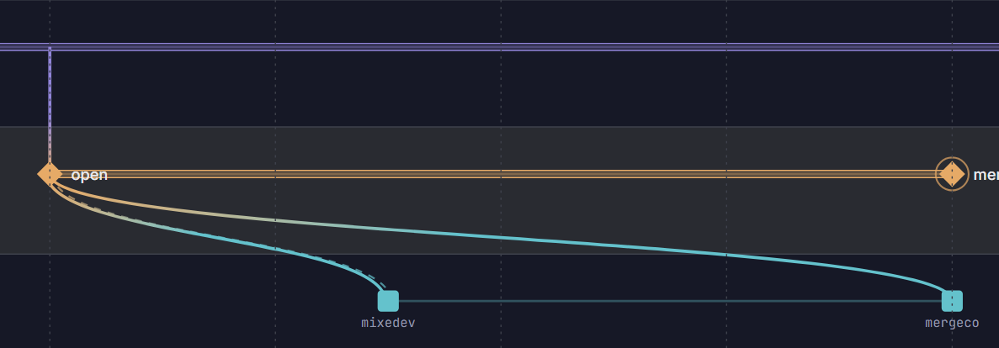

**Encodes:** *what the link reaches*, not what it leaves. `resolves` and `references_issue`
take the issue colour; `contains_commit` and `merge_commit` take the commit colour
(`QUALIFIER`, `theme.js:45`). Each qualifier has exactly one direction in the data, so
"what it reaches" is a property of the qualifier rather than something the renderer works
out per edge.

### C8 · Relationships-mode edges

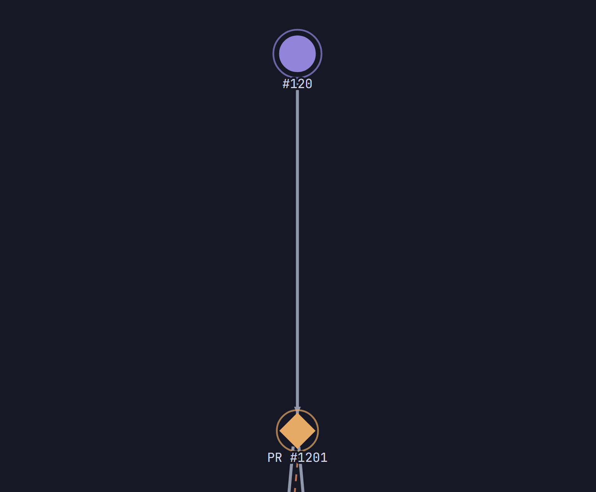

**Where:** relationships mode. **Encodes:** the same links, drawn structurally. Validated is
`var(--color-neutral-500)`, extracted is `COLORS.extracted`; when a pair carries both, one
line per evidence class is drawn at a 5 px offset, so a dashed link can never hide under a
solid one. The 7 px arrowhead points at the **temporally later** end
(`edgeDirection`, `structural.js:272`). `data-legend="precedence-arrow"`.

### C9 · Actor trail and rings

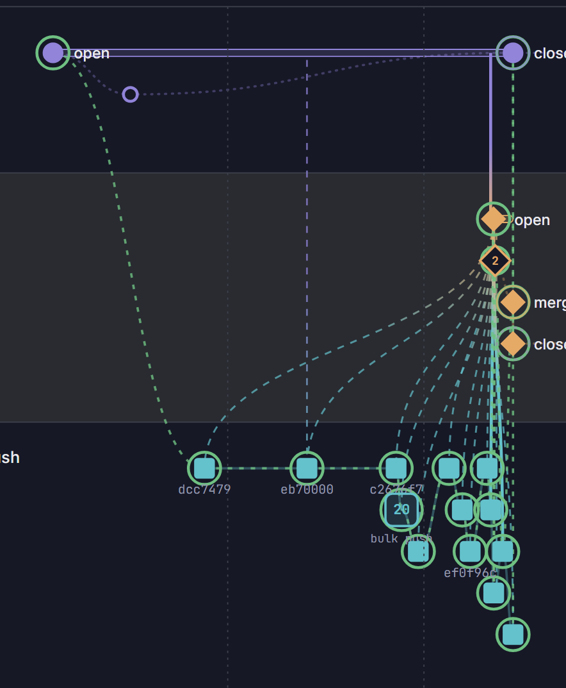

**Where:** halo layer, once an actor is pinned in the Actors section. **Encodes:** one
person's path through the sub-log. Dashed `4 6` in the actor's colour at 0.8 opacity, with
a ring around every mark they touched. `ACTOR_PALETTE` holds 6 oklch hues.

Rings come in two forms — solid where the mark is theirs alone, dashed `5 4` where the mark
is folded and holds other people's events too:

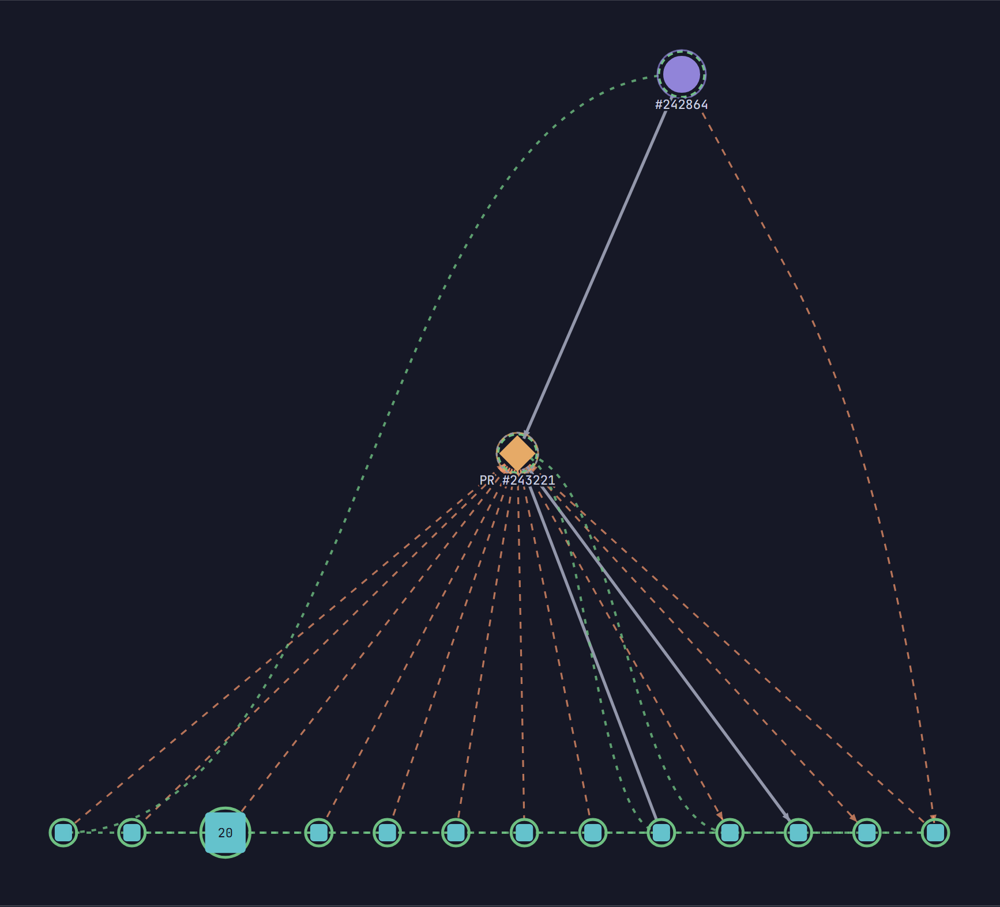

In relationships mode, where every object collapses its whole lifecycle into one mark,
2 of 15 rings were dashed for the first actor; in absolute mode the same actor produced
19 rings and none dashed, because nothing they touched was folded.

### C10 · Focus dimming

Degree 1 — everything more than one hop from issue #242864 falls to `DIM_OPACITY = 0.15`:

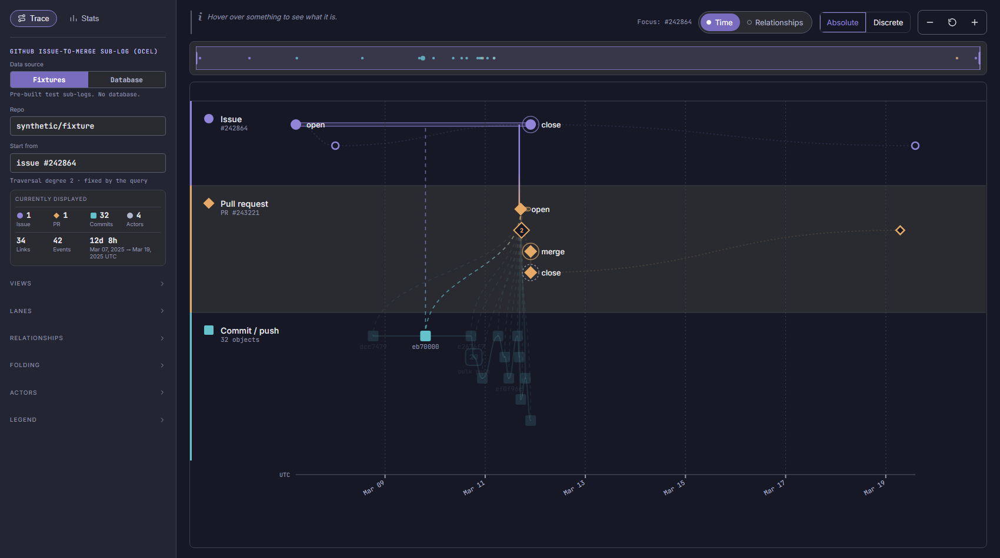

Degree 2 — the commits behind the PR come back:

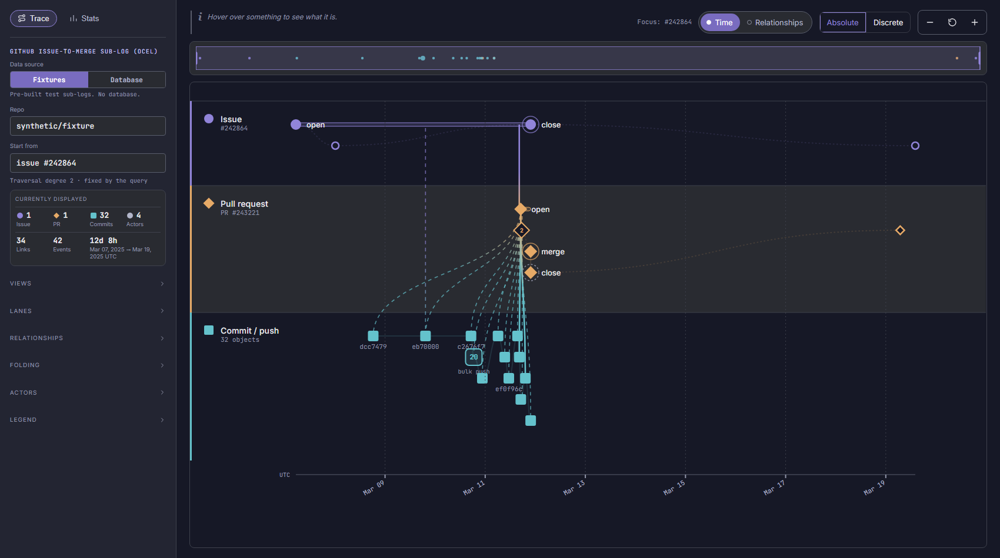

**Encodes:** a client-side BFS neighbourhood (`focusSet`, `src/model/graph.js:63`), with
graded falloff `FOCUS_FALLOFF = [1, 0.8, 0.55]`. This is **focus degree**, not traversal
degree: it changes what is highlighted, never what was fetched.

### C11 · Brushed-out dimming

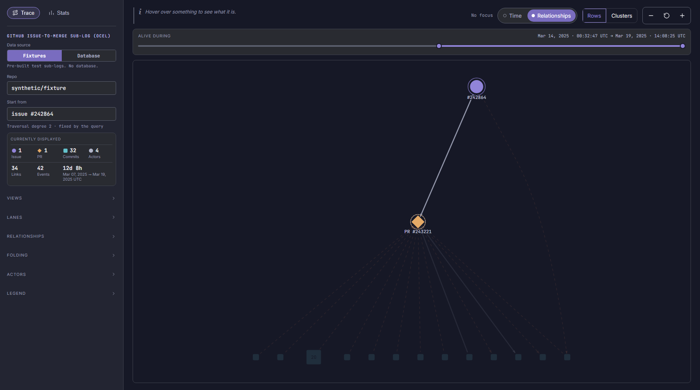

**Where:** relationships mode. **Encodes:** marks alive outside the brushed time range,
dimmed to 0.13 rather than removed.

---

## D. Graph types

### D1 · Time → Absolute

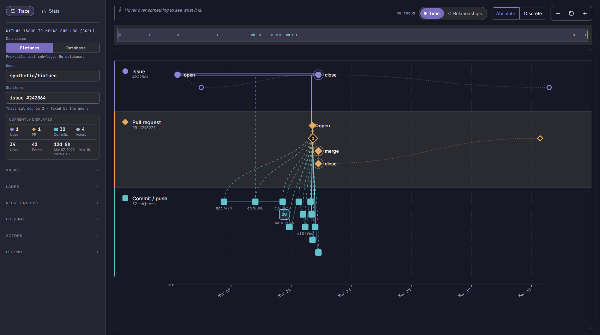

Three lanes in `LANE_TYPES` order — issue, pull_request, commit — on a linear UTC scale
over `[first, last]`. Actors have no lane; they appear as trails and rings. This is the
default mode.

### D2 · Time → Discrete

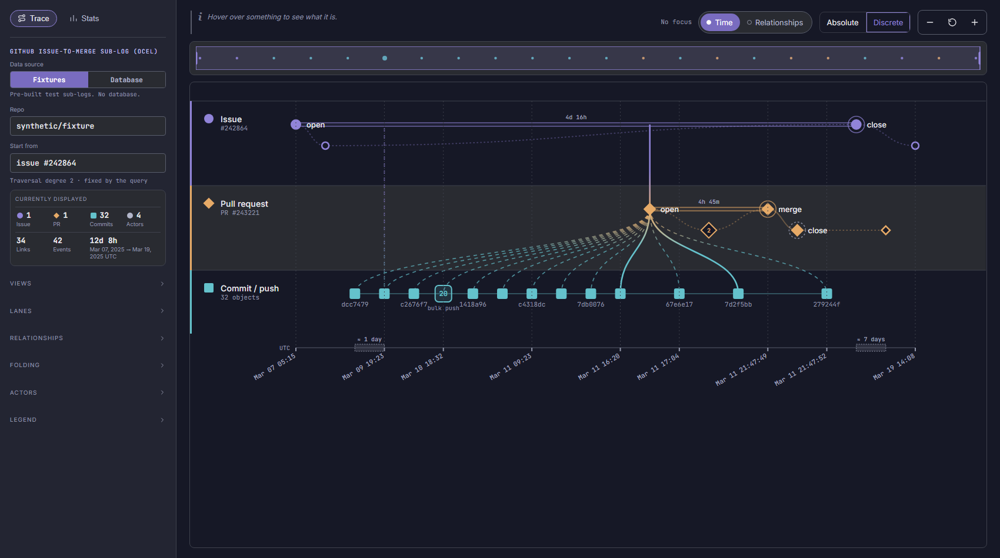

The same sub-log by *rank* rather than by clock: one column per mark, so a burst of
activity gets the same room as a quiet month. Idle stretches are annotated instead of
drawn to scale.

Gap annotations, from LIVE2 where they merge:

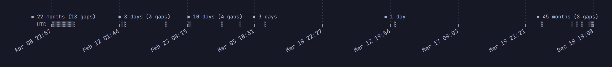

`findLargeGaps` flags rank gaps over `GAP_THRESHOLD_MS` (24 h); adjacent labels closer than
14 px merge into `≈ N (k gaps)`. The `UTC` label at the axis origin is permanent — all
times in this tool are UTC, parsed and rendered.

### D3 · Relationships → Rows (layered)

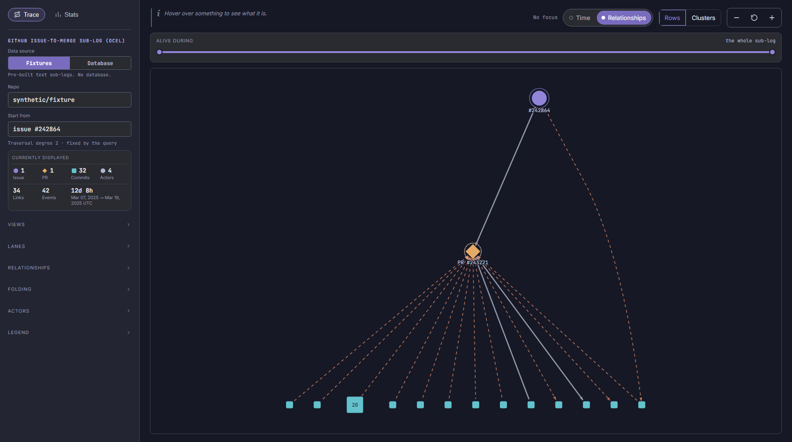

Deterministic, no force simulation: rows in `LAYER_ORDER` issue → pull_request → commit,
dummy nodes inserted for row-skipping edges, barycentre ordering over 8 sweeps keeping the
best, then 6 alignment passes at strength 0.85.

The same layout on LIVE2's 147 objects:

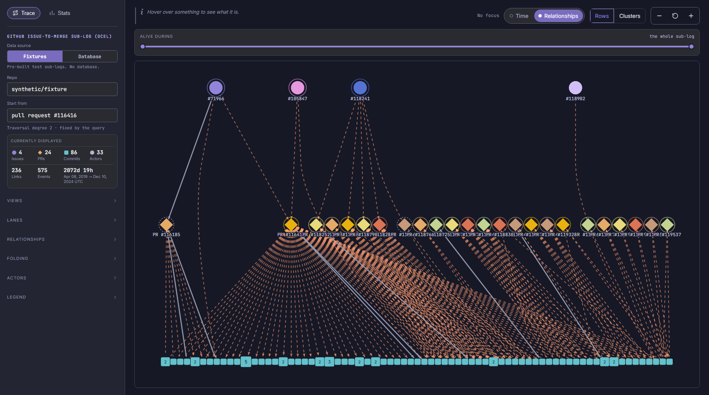

### D4 · Relationships → Clusters (cluster)

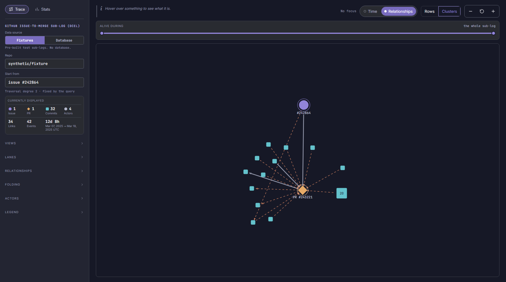

Rings around a root: `assignLayers` gives levels, each node's parent is its first linked
upper-level node by sorted id, ring radii come from `measure` with a fan of `π × 1.35`
(`2π` at the root), then d3-force relaxes until `alpha < alphaMin`. `anchorId` is the
highest-degree root.

On LIVE2:

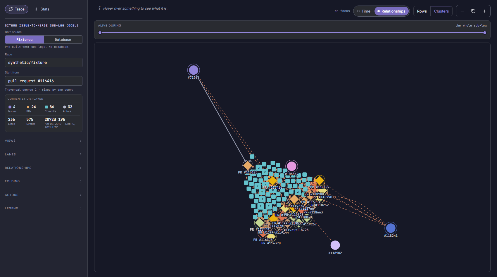

At this size the cluster overlaps heavily and labels overprint — a readability limit of the
layout on a 147-object sub-log, not a capture artefact.

### D5 · Sub-lane bands

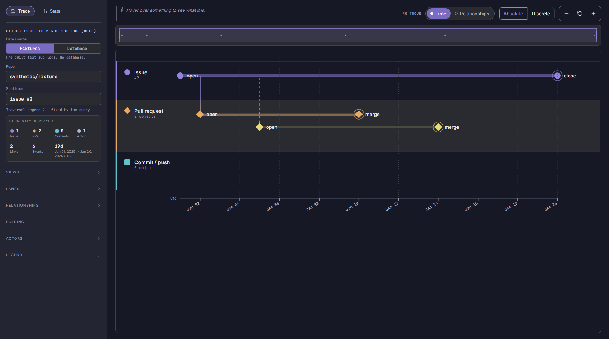

**Encodes:** two objects whose lifetimes overlap cannot share a row, so `assignSubLanes`
partitions the issue and PR lanes into bands greedily, reusing a band only when
`bandEnd <= start`. F3's two overlapping PRs therefore occupy two bands.

F4, two overlapping issues against one PR:

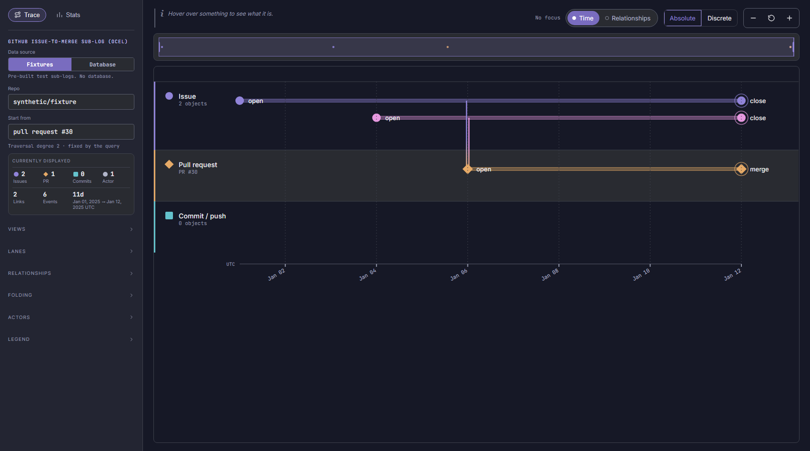

### D6 · Commit lane with repeatRow

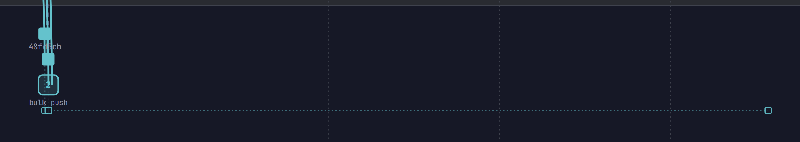

**Encodes:** the commit lane gains exactly one extra row when any commit was observed more
than once; the repeat markers live there, elbowed back to the first observation.
Captured from **LIVE1**, not F10 — see [§J](#j-observations-the-capture-turned-up).

---

## E. Axis, navigation, overlays

### E1 · Absolute axis

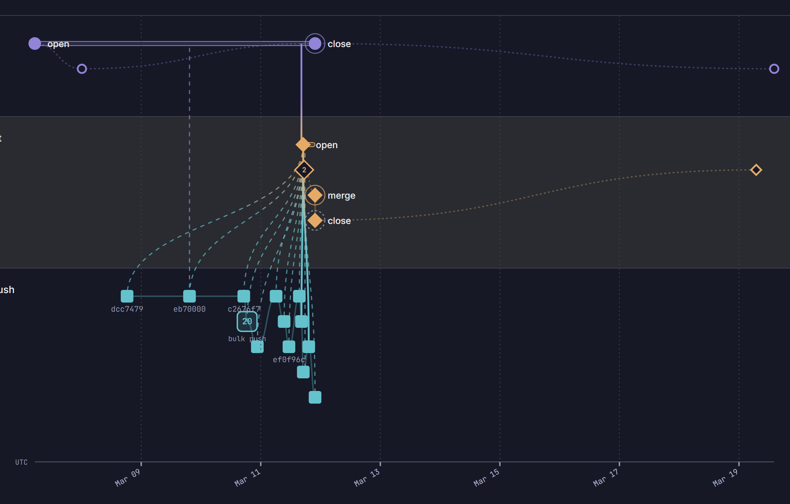

d3 UTC ticks, roughly `6 × zoom` of them, with the `UTC` label pinned at the origin.
Labels closer than 14 px merge; closer than 110 px stagger onto two rows.

### E2 · Discrete axis

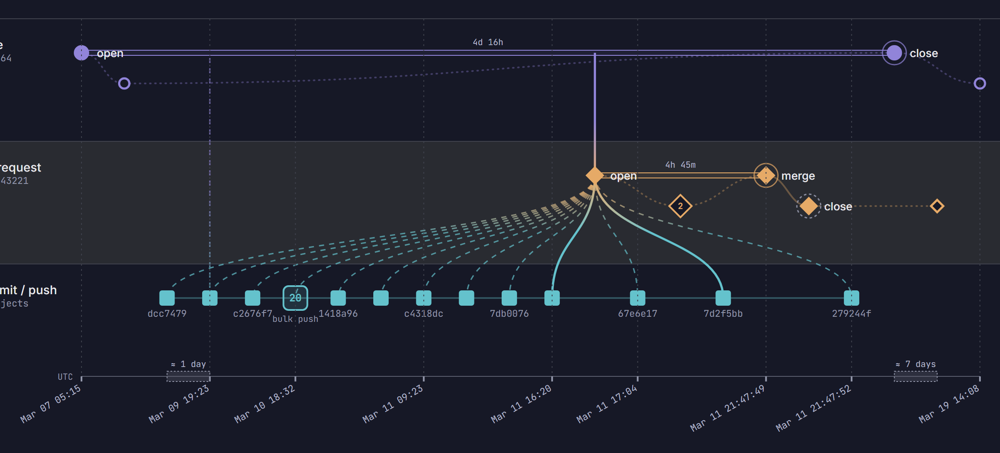

At most 9 ticks, placed by rank rather than by time, with the gap bands of D2.

### E3 · Minimap

**Where:** above the canvas, temporal modes only. **Encodes:** the whole sub-log's density
in one strip, with the current viewport as a rectangle and a drag-to-zoom grip at each end.
Clicking centres; dragging the rectangle pans.

After dragging the viewport rightwards:

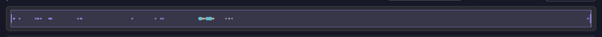

### E4 · Time brush

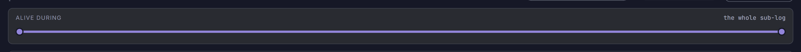

**Where:** relationships mode only, labelled *ALIVE DURING*. Two sliders over fractions of
the extent; out-of-range marks dim rather than disappear (C11). Reads
"the whole sub-log" when unbrushed.

### E5 · Focus state and the floating degree stepper

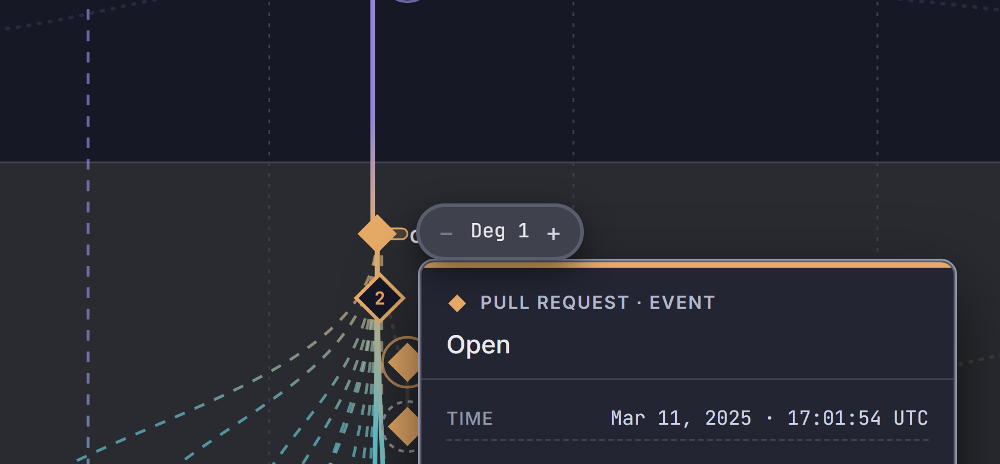

Clicking a mark focuses its object and raises a `− Deg 1 +` stepper at the pointer, capped
at `MAX_FOCUS_DEGREE = 2`. `#focusInfo` in the top bar switches from *No focus* to
*Focus: #242864*. Background click clears. The tooltip is present here because the pointer
is still over the mark it clicked.

### E6 · Drag-nudged node

Before, in relationships/Rows:

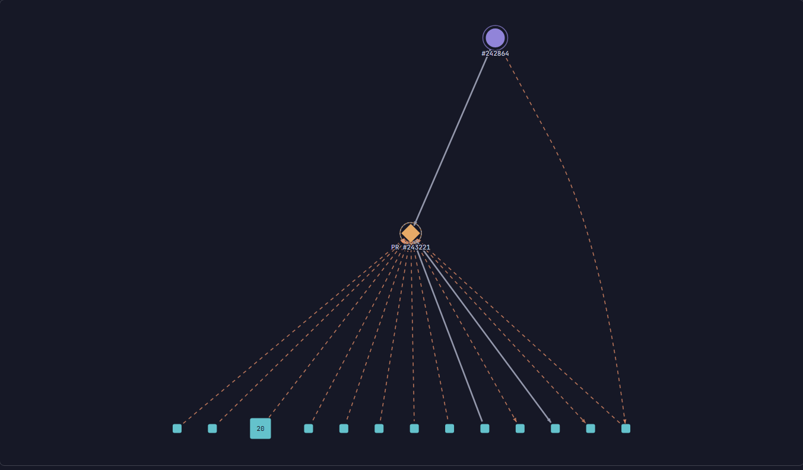

After dragging the PR node up and to the right:

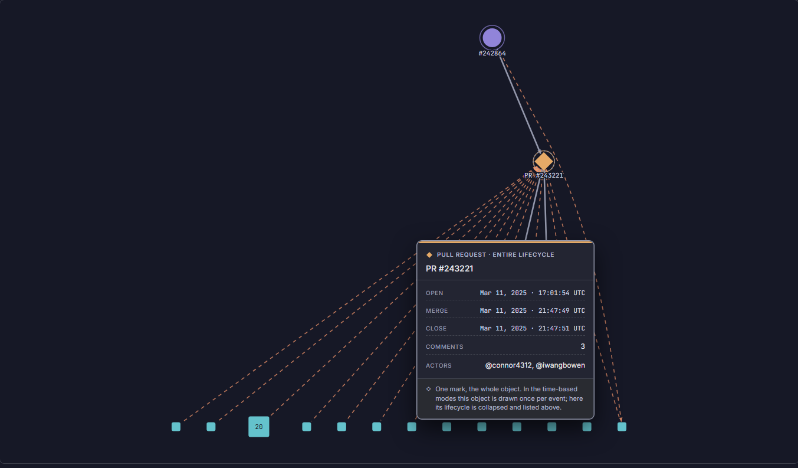

**Encodes:** a manual offset stored per layout in `state.nodeNudges`
(`Map<structuralLayout, Map<nodeId, {dx,dy}>>`). Cluster runs a live drag simulation
(home strength 0.08, velocityDecay 0.55); layered instead pushes neighbours apart with
`pushApart`. Nudges are cleared by zoom-reset and are not saved in a preset.

---

## F. Sidebar, cards, panels

### F1 · Sub-log card

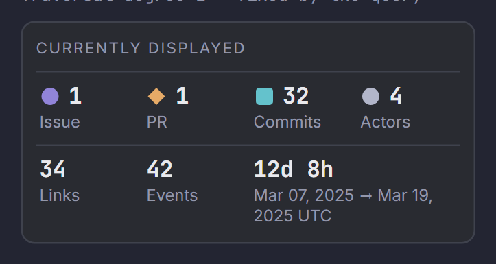

**Encodes:** what is currently displayed — counts per object type, links, events, and the
span. Filtered, it switches to `n / total` and adds *of the sub-log*:

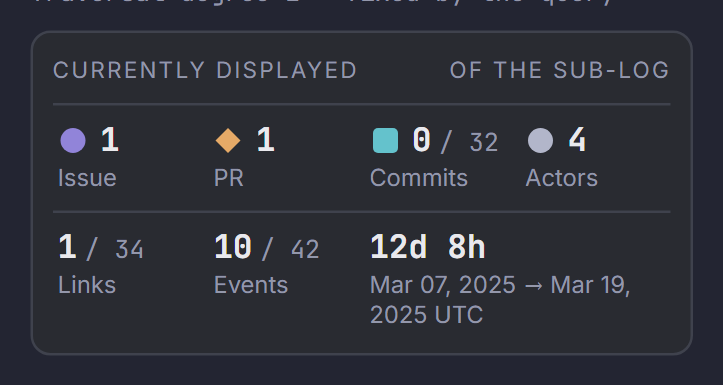

With the commit lane off, F1 reads `0 / 32` commits, `1 / 34` links, `10 / 42` events —
metrics are computed in JS over the loaded sub-log, so every figure answers to the toggles.

### F2 · Views

The four built-ins: *Everything*, *Validated links only*, *Lifecycle without commits*,
*Commit integration focus*. Below them, *Save current view* and *Copy link*.

With a saved view, which gains rename and delete controls:

Saved views live in `localStorage` under `ocpm_viz.presets.v1`. A snapshot (v2) carries
mode, structural layout, lanes, comments, hidden objects, hidden commit groups, rel pairs,
qualifiers and methods — **not** zoom, scroll, focus, bursts, nudges or brush.

### F3 · Lanes

Collapsed to its three lane masters:

Opened, each lane reveals its comment toggle and its individual objects:

The commit lane instead lists **commit groups**, one per PR — LIVE2 has 24:

and a trailing *Not linked to a PR* group wherever unattributed commits exist. F7, whose
commits carry no links at all, is the clean case:

A commit is visible if **any** group containing it is visible
(`isCommitInVisibleGroup`, `src/model/commitGroups.js:90`).

### F4 · Relationships

Four collapsed masters: *Validated links*, *Extracted links*, *Qualifiers*, *Detection
methods*. Opened, each lists its children with counts:

The vocabulary is derived from the loaded links by `deriveRelGroups`, `deriveQualifiers`
and `deriveMethods` — there is no hardcoded enumeration. A master shows an indeterminate
state when only some children are on, and a type pair is disabled when its lane is hidden.

### F5 · Folding

Push folding is fixed by `push_id` and only reports how many are folded; the comment
window is a 0–30 day slider feeding `deriveCommentBursts`.

### F6 · Actors

A login filter and one row per actor: colour swatch, `@login`, event count, and a profile
button. Hovering a row previews that actor's trail; clicking pins it.

### F7 · Legend

All 16 Trace keys in five sections — Objects, Marks, Links, Relationships mode, Lines — 17 rows,
`comments` appearing under both Marks and Lines; the Process map section (3 keys) is dimmed on the
Trace page and lives in the Process page's own legend. Rows for
keys absent from the current render drop to 0.32 opacity rather than disappearing, because
a row that vanishes cannot say whether the mark is missing from the data or missing from
the mode. In F1's absolute view the dimmed rows are `landmark-heuristic`,
`repeat-observation`, `link-crowded`, `precedence-arrow` and `actor-trail`.

Presence is read off the drawing itself (`legendKeysPresentIn`), not re-derived from the
model — a second copy of "which marks get drawn" is exactly what decision 82 forbids.

Hovering a legend row highlights every matching mark on the canvas:

### F8 · Hidden banner

One chip per hidden thing — here *Commit lane hidden* — each restoring on click, plus
*Show everything*. Built by `summarizeHidden`.

### F9 · Help strip

Reads *Hover over something to see what it is.* by default (visible in D1), and resolves
`data-tip` → `data-tipArg` → `data-legend` → `legend.<key>` on mouseover and focusin.
77 keys in `src/help/tips.js`; `tests/tips.test.js` fails if a key has no text or a text
has no key.

---

## G. Tooltips and cards

Every variant below is one hovercard built by `createTooltip`. Hover shows and follows it;
right-click pins it; Esc or the × closes it; clicking a row copies that value.

| Variant | Shot | What it carries |
|---|---|---|
| Issue / PR event |  | kicker, activity, time, actor, object |
| Comment, with excerpt |  | the comment body, capped at 500 chars with a truncation note |
| Commit |  | time, git author, pushed by, ref, push id, message |
| Bulk push |  | member count, push id, span |
| Comment burst |  | how many comments, from/to |
| Fold handle |  | what folding back would do |
| Timeline link |  | qualifier, evidence badge, method, methods agreeing |
| Relationships node |  | lifecycle rows, comments, actors |
| Relationships edge |  | qualifier and method per member, evidence, temporal order |
| Repeat marker |  | which push re-observed the commit |

The commit card carries a standing honesty note — *Time = first observed in a PushEvent
(not real git commit time). The git author is a commit string, not a GitHub account, and
the two are never matched* — which is the `data_honesty` block of the payload surfacing at
the point of reading.

**Pinned**, with the × and the *Click a row to copy · Esc to close* footer:

### G12 · Actor card

Opened from the profile button on an actor row. Avatar in the actor's colour, `@login`, a
GitHub link, and their activity as rows — hovering a row rings the corresponding mark,
clicking copies. Ends with the identity disclaimer, since actors are keyed by login in the
fixtures and by numeric id in the live payload.

---

## H. Stats page

### H1 · Table, aggregates collapsed

Columns: Object, Open for, Events, Comments, Actors, Links, Longest gap, Handoffs,
Outcome. One collapsible aggregate row per type carrying median and min–max.

### H2 · Aggregates expanded

Per-object rows beneath each type.

### H3 · Cards

Link evidence, PR outcomes, Commits, Actors and comments, Lead times, Longest idle gaps.
Lead times are the three fixed spans: first issue → first commit, first issue → first PR,
first merge → first issue close.

### H4 · Landmarks card

The emphasised terminal activities in order.

### H5 · Filtered notice

Shown whenever the page is reading a filtered sub-log. Every figure comes from
`selectVisible`, so hiding the commit lane changes the table rather than leaving a stale
number — which is the failure decision 12 exists to prevent.

The two sidebar dashboard checkboxes toggle the last two cards.

---

## I. Messages, motion, and the database source

### I1 · Seed prompt

The database source cannot offer a default seed — picking one for the reader would put an
arbitrary sub-log on screen that nobody asked for — so a repo without a seed prompts
instead of loading (decision 34).

### I2 · Error surface

`errorHtml` renders the failure in a `<pre>`, here for a fixture that does not exist. A
failed search says so rather than reporting "no matches", which would be a different and
wrong statement.

### I3 · Toast

1.8 s confirmation, here after saving a view.

### I4 · Burst expansion (FLIP)

| Start | Settled |
|---|---|
|  |  |

The expansion is a 450 ms FLIP. Only these two states could be captured — see
[§J](#j-observations-the-capture-turned-up).

### I5 · Structural idle drift

| t ≈ 0.9 s | t ≈ 4.2 s |
|---|---|
|  |  |

After the 620 ms settle, relationships marks drift 2.4 px on a 5200 ms cycle. The two
frames differ; the movement is deliberately below the threshold at which it would read as
a change in the data. All of it is suppressed under `prefers-reduced-motion`.

### I6 · Database source

The same renderer against PostgREST — `microsoft/vscode`, seed `pr:571599565`, traversal
degree 2. Nothing above the data layer distinguishes this from a fixture.

Seed search over 283,842 candidate objects in that repo: SQL filters, JavaScript ranks.
The list reveals 15 rows at a time as it is scrolled, and says so when the 200-row cap is
reached.

Traversal degree is editable against the database (0–2) and fixed against the fixtures,
where the sub-log was pre-built. This is **traversal degree** — what is *in* the sub-log —
not the focus degree of E5.

---

## J. Observations the capture turned up

Facts, recorded because the inventory is only as good as its checklist. Nothing here was
changed.

1. **`actor-trail` is never present until an actor is pinned.** Its legend row is dimmed in
   every fixture on load. It is the only legend key that no data can produce on its own.

2. **F10 has no repeat observations.** The task list attributed the `repeatRow` to F10;
   probing all 14 fixtures for rendered `data-legend` keys shows `repeat-observation` only
   in LIVE1 and LIVE2. F10's 300 commits are spread over 24 pushes, but none is pushed
   twice. D6 was captured from LIVE1.

3. **LIVE2 has no *Not linked to a PR* group.** All 24 of its commit groups are PR groups;
   every commit is attributed. F7 is the fixture that exercises the unlinked group.

4. **Focus degree 2 is indistinguishable from degree 1 when focusing F1's PR.** The two
   renders were byte-identical, because everything in F1 is within one hop of the PR. The
   degrees only diverge from the issue, which is what C10 shows.

5. **A URL-supplied `focusDegree` applies to the render but the stepper stays hidden.**
   `updateDegreeStepper()` is called only from `showDegreeStepper()` — which needs pointer
   coordinates — and from the ± handlers (`src/main.js:563, 580, 588`). With
   `?focus=…&focusDegree=2` the dimming is correct and `state.focusDegree` is 2, while the
   never-shown `#degVal` still reads its markup default of 1. Not visible to a user, but it
   means E5 had to be captured by clicking a mark, not from a URL.

6. **Copy link falls back to `window.prompt`.** When `navigator.clipboard.writeText`
   rejects — as it does in a headless browser without clipboard permission —
   `src/render/controls.js:242` opens a prompt instead of toasting. I3 was therefore
   captured from *Save current view*, whose toast does not depend on the clipboard.

7. **Cluster layout overlaps badly at LIVE2's size.** Marks and labels overprint in D4's
   second shot. `docs/RELATIONSHIPS_MODE.md` records the layout's weak points; this is a
   picture of one.

### Not captured

- **True intermediate FLIP frames.** Sampling at 40/110/190/280/380 ms produced only two
  distinct images — the start pose and the settled pose. Each capture costs a CDP
  round-trip before the screenshot, which is enough to overshoot a 450 ms transition that
  is already most of the way done. The start and end states are in I4; the motion between
  them is not.
- **The two remaining issue shades.** `OBJECT_SHADES.issue` holds 6; no fixture has more
  than 4 issues, so shades 5 and 6 cannot be drawn from fixture data. Their values are
  quoted in A5.
- **Minimap drag-to-zoom grips mid-gesture.** The grips are visible in E3 and the result of
  a viewport drag is in E3b, but the transient state while a grip is held is not a distinct
  rendering.

---

## Checklist

**A. Object glyphs**
- [x] Issue circle · PR diamond · commit square — A1, A2, A3
- [x] Per-object shades — A5 (all 6 PR shades; 4 of 6 issue shades — *not captured: no fixture holds ≥ 6 issues*)
- [x] Comment mark, hollow — A4
- [x] Landmark ring — A6
- [x] Heuristic landmark ring (F14) — A7
- [x] Closed-unmerged ring (F14) — A8
- [x] Repeat-observation marker — A9 (*from LIVE1, not F10*)
- [x] Commit label text and thinning — A10

**B. Folding / bursts**
- [x] Folded push burst — B1
- [x] Expanded burst and fold handle — B2
- [x] Comment burst, folded and expanded, with handle — B3
- [x] Burst node in relationships mode — B4

**C. Lines and links**
- [x] Lifecycle bar, reopened issue = two bars — C1
- [x] Lifecycle bar in discrete mode — C2
- [x] Sequence line with dashed comment segments — C3
- [x] Validated vs extracted — C4
- [x] Link gradient — C5
- [x] Fanned links and ×N badge — C6
- [x] Qualifier colouring — C7
- [x] Relationships edges: evidence styling, 5 px offset, precedence arrow — C8
- [x] Actor trail, rings, shared-ring dash — C9
- [x] Out-of-focus and brushed-out dimming — C10, C11

**D. Graph types**
- [x] Absolute — D1
- [x] Discrete with gap annotations — D2
- [x] Relationships → Rows — D3
- [x] Relationships → Clusters — D4
- [x] Sub-lane bands — D5
- [x] Commit lane with repeatRow — D6

**E. Axis, navigation, overlays**
- [x] Absolute and discrete axes, merged/staggered labels, UTC — E1, E2
- [x] Minimap with viewport and grips — E3 (*mid-gesture grip state not captured*)
- [x] Time brush and dimmed out-of-range marks — E4, C11
- [x] Focus state, degree 1 vs 2, floating stepper, `#focusInfo` — E5, C10
- [x] Drag-nudged node, before and after — E6

**F. Sidebar, cards, panels**
- [x] Sub-log card, normal and filtered — F1
- [x] Views, built-ins and a saved view with rename/delete — F2
- [x] Lanes: masters, comments, per-object hide, commit groups incl. unlinked — F3
- [x] Relationships: masters, pairs, qualifiers, methods, counts — F4
- [x] Folding: push label and comment window slider — F5
- [x] Actors: search and rows — F6
- [x] Legend: 17 rows, dimmed absent rows, hover highlight — F7
- [x] Hidden banner with chips and Show everything — F8
- [x] Help strip, default and resolved — F9, D1

**G. Tooltips and cards**
- [x] All 10 tooltip variants and the pinned state — G table, G11
- [x] Actor card — G12

**H. Stats page**
- [x] Table, aggregates collapsed and expanded — H1, H2
- [x] All six cards plus Landmarks — H3, H4
- [x] Filtered notice — H5

**I. Messages and motion**
- [x] Seed prompt, error surface, toast — I1, I2, I3
- [x] Burst expand FLIP — I4 (*start and settled only; intermediate frames not captured*)
- [x] Structural settle / idle drift — I5

**Beyond the task list**
- [x] Database source, seed search dropdown, traversal degree stepper — I6
